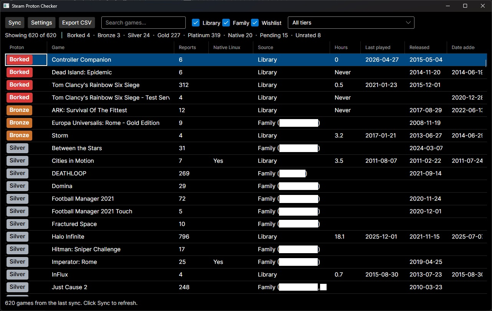
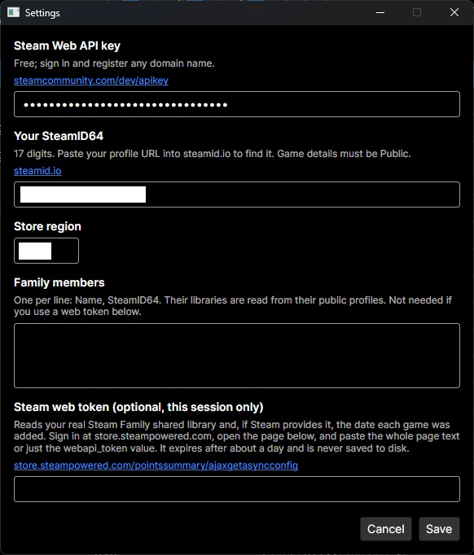
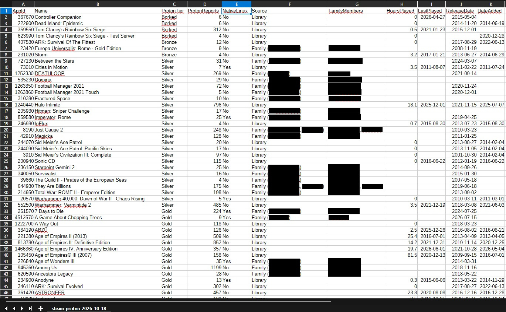

# Steam Proton Checker

A cross-platform desktop app (Avalonia, .NET 8) that checks every game in your
Steam library, your Family Library and your wishlist against
[ProtonDB](https://www.protondb.com). The original goal was to give insight into which games would be likely 
to give you trouble before a migration from Windows to Linux.

Games are listed worst to first (Borked, Bronze, Silver, Gold, Platinum, Native, then
Pending/Unrated) and every column is sortable: compatibility, hours played, last
played, release date and date added.

## Run it

```
git clone https://github.com/<you>/steam-proton-checker.git
cd steam-proton-checker
dotnet run --project SteamProtonChecker
```

Requires the [.NET 8 SDK](https://dotnet.microsoft.com/download). Tagged releases
(`v*`) build self-contained zips for `win-x64`, `linux-x64` and `osx-arm64`.

On first launch the Settings window opens:

1. **Steam Web API key**: free at <https://steamcommunity.com/dev/apikey>.
2. **Your SteamID64**: paste your profile URL into <https://steamid.io>.
3. **Store region**: `ca`, `us`, ... (used for store requests).
4. Optional: **family members** and/or a **web token** (see below).

Your Steam profile's **Game details** must be Public (family members' profiles too, if
you list them). Then click **Sync**.

## Screenshots





## Using it

- Click any column header to sort; Shift-click to add a second sort key.
- Filter by source (Library / Family / Wishlist), by tier group
  ("Likely trouble: Borked + Bronze", "Unknown", ...), or by name.
- Double-click a game to open its ProtonDB page and read the actual reports.
- **Export CSV** saves the games currently shown (after filters, in the current sort order).
- **Native Linux** means the store lists a Linux build. A game with a native build and
  no ProtonDB verdict is shown as *Native* rather than *Unrated*.
- *Pending* means ProtonDB has some reports but not enough for a tier. *Unrated* means
  none. Treat both as unknown, not as a pass.
- Reports shows how many ProtonDB reports back the tier; a Gold from 3 reports is
  weaker evidence than a Gold from 3,000.

## Family games

There are two ways to include family games:

- **Family members list** (Settings): one `Name, SteamID64` per line. The app reads
  each person's *public* library. This is an approximation of the shared library:
  it can include games Steam doesn't allow to be shared.
- **Web token** (optional): reads your real Steam Family shared library, and if Steam
  includes it, the date each of your games was added. Steam's `IFamilyGroupsService`
  rejects a normal API key, so this needs the short-lived token of a signed-in store
  session: sign in at store.steampowered.com, open
  <https://store.steampowered.com/pointssummary/ajaxgetasyncconfig>, and paste the
  page text (or just the `webapi_token` value) into Settings. It expires after about a
  day and is **never saved to disk**. When a token is given it replaces the
  family-members list for that sync.

## Known limitations

These endpoints are unofficial, so they can change without notice:

- **ProtonDB** summaries (`/api/v1/reports/summaries/{appid}.json`): the same JSON the
  ProtonDB site and browser extensions use.
- **Release dates and the Linux flag** come from `IStoreBrowseService/GetItems`.
- **Family shared library** and **date added** come from `IFamilyGroupsService`. The
  acquisition date is only shown if Steam returns it; there is no documented API for
  "date added to library", so that column may be empty.
- ProtonDB's tier is a community consensus, not a guarantee. Games with kernel-level
  anti-cheat are the most common outright failures; see
  <https://areweanticheatyet.com>.

Results are cached in a local SQLite database (`%AppData%\SteamProtonChecker` on
Windows, `~/.config/SteamProtonChecker` on Linux). Release data is refreshed after 14
days and ProtonDB data after 7, so re-syncing is quick.

## Architecture

The dependency rule flows one way, outer to inner.

- `SteamProtonChecker.CoreModels`: domain models (`CheckedGame`, `ProtonTier`,
  `AppSettings`) and the `IGameRepository` abstraction. No dependencies.
- `SteamProtonChecker.ApiClients`: thin wrappers over Steam, the store and ProtonDB
  (`SteamWebApiService`, `SteamWishlistService`, `SteamStoreService`,
  `SteamFamilyService`, `ProtonDbService`).
- `SteamProtonChecker.Infrastructure`: SQLite cache (`GameRepository`) and
  `settings.json` (`AppSettingsStore`).
- `SteamProtonChecker.Services`: `LibraryChecker` (sync orchestration) and
  `LibraryMerge` (pure merge rules).
- `SteamProtonChecker`: the Avalonia UI.
- `SteamProtonChecker.Tests`: xUnit tests; HTTP is faked, so no test touches the network.

```
dotnet test
```
